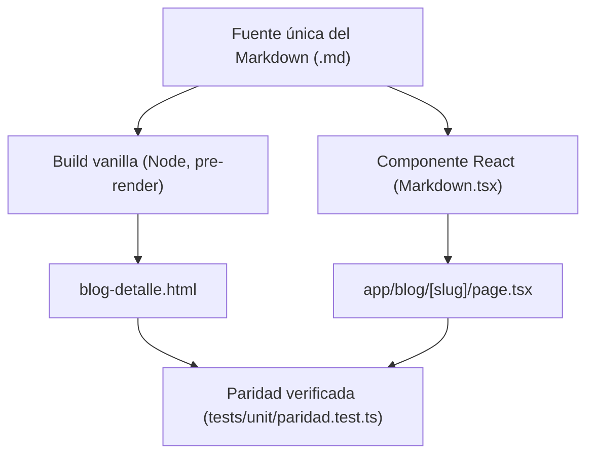

# La estructura del catálogo ampliado de Glassmorphism

Cuando el laboratorio **Design-HTML** dejó de ser una landing y un dashboard de ejemplo
para convertirse en el catálogo de referencia de Carlos, la primera pregunta no fue
*"qué variantes visuales construimos"*, sino una más aburrida y más importante: *¿qué
vistas existen y qué secciones tiene cada una?* Fijar esa estructura antes de explorar
variantes evita reconstruir siete veces algo que todavía es inestable.

Este artículo documenta esa decisión — el llamado `ADR-002` — y, de paso, sirve como
contenido real para demostrar el componente de **Markdown reutilizable** que ambas pistas
(vanilla y React) comparten.

## Por qué siete vistas y no dos

El piloto original (`glassmorphism`) solo tenía *Landing* y *Dashboard*. El catálogo
ampliado añade *Blog listado*, *Blog detalle*, *Productos listado*, *Producto detalle* y
*Contacto*. La regla que ordena todo el trabajo es sencilla:

> Una sola instancia de cada componente. Las variantes llegan después, en specs propias.

Esto evita el error clásico de construir seis estilos de tarjeta antes de saber si la
tarjeta en sí está bien resuelta.

### Paridad entre pistas

Ambas pistas — `glassmorphism/` (HTML + CSS + JS vanilla) y `react/glassmorphism/`
(Next.js) — avanzan **en paralelo** y deben mantener paridad estructural: los mismos
componentes, el mismo contenido, solo cambia el mecanismo de tokens (variables CSS vs.
Tailwind). El diagrama siguiente resume cómo se reparte el trabajo por zona.



## Las siete vistas, una por una

1. **Landing** — navbar, hero, cards de feature, carrusel/galería y footer.
2. **Dashboard** — topbar, sidebar, un gráfico, una alerta, una tabla, un registro de
   detalle y un formulario placeholder.
3. **Blog listado** — grid de posts con imagen, título, extracto y fecha.
4. **Blog detalle** — *esta misma página*, renderizada vía el componente Markdown.
5. **Productos listado** — grid de productos con imagen, nombre y precio.
6. **Producto detalle** — descripción en **texto plano**, sin Markdown (decisión
   explícita: el detalle de producto no necesita texto enriquecido).
7. **Contacto** — formulario validado en cliente, sin backend real.

### Lo que el componente Markdown debe soportar

El contrato de salida (`RF-004`) exige que el renderer cubra, como mínimo:

- Encabezados `h1` a `h6`.
- Énfasis: **negrita**, *cursiva* y ~~tachado~~.
- Listas ordenadas, desordenadas y anidadas.
- Citas en bloque.
- Código `inline` y en bloque, con resaltado de sintaxis real cuando el lenguaje se
  declara.
- Al menos un diagrama Mermaid (como el de arriba).
- Tablas, enlaces, imágenes con texto alternativo y reglas horizontales.

Un ejemplo de bloque con lenguaje declarado — el script que genera la versión vanilla
desde esta misma fuente `.md`:

```ts
import { readFile, writeFile } from "node:fs/promises";

async function buildVanillaMarkdown(slug: string) {
  const source = await readFile(`content/blog/${slug}.md`, "utf8");
  const html = await renderMarkdownToHtml(source);
  await writeFile(`../glassmorphism/blog-detalle.html`, html, "utf8");
}
```

> La fuente única del Markdown es lo que garantiza cero divergencia de contenido entre
> las dos pistas: ambas leen (directa o indirectamente) el mismo `.md`.

## Resultado visual


La tabla siguiente resume el estado de cada vista al cierre de esta spec:

| Vista | Pista vanilla | Pista React | Estado |
|---|---|---|---|
| Landing | `index.html` | `app/page.tsx` | Completa |
| Dashboard | `dashboard.html` | `app/dashboard/page.tsx` | Completa |
| Blog listado | `blog.html` | `app/blog/page.tsx` | Nueva |
| Blog detalle | `blog-detalle.html` | `app/blog/[slug]/page.tsx` | Nueva |
| Productos listado | `productos.html` | `app/productos/page.tsx` | Nueva |
| Producto detalle | `producto-detalle.html` | `app/productos/[slug]/page.tsx` | Nueva |
| Contacto | `contacto.html` | `app/contacto/page.tsx` | Nueva |

Para más contexto sobre la decisión original, revisa el
[registro de `ADR-002`](https://design-html.local/decisions/ADR-002) (enlace de
referencia interno del laboratorio).

---

Con la estructura fija, el siguiente paso del roadmap son las variantes: distintos
estilos de navbar, hero, tarjetas y, más adelante, un sistema formal de tokens de
motion. Pero eso es contenido de otro artículo.
