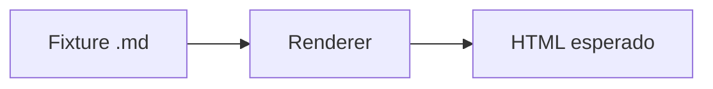

<!--
  Fixture-contrato de RF-004 / RF-011 / RF-014 / RF-015 (SPEC-0002).
  Cada construcción de Markdown que el renderer (vanilla + react) debe soportar
  aparece aquí exactamente una vez, en un bloque identificable, para que
  tests/unit/markdown.test.ts pueda localizarla y aserte su HTML de salida.
  No es contenido de dominio: es el contrato de construcciones del showcase.
-->

# Encabezado nivel 1

## Encabezado nivel 2

### Encabezado nivel 3

#### Encabezado nivel 4

##### Encabezado nivel 5

###### Encabezado nivel 6

## Énfasis

Texto con **negrita**, texto con *cursiva* y texto con ~~tachado~~ en la misma oración
para probar los tres juntos y por separado.

## Listas

Lista desordenada:

- Primer elemento
- Segundo elemento
- Tercer elemento

Lista ordenada:

1. Paso uno
2. Paso dos
3. Paso tres

Lista anidada (desordenada dentro de ordenada):

1. Elemento raíz uno
   - Sub-elemento A
   - Sub-elemento B
2. Elemento raíz dos
   - Sub-elemento C
     - Sub-sub-elemento C.1

## Blockquote

> Esta es una cita en bloque de una sola línea para verificar el `<blockquote>`.
>
> Y esta es una segunda línea de la misma cita, en un párrafo separado.

## Código inline

Usa `const x = 1;` para declarar una constante inline dentro de una oración normal.

## Código en bloque CON lenguaje declarado

```ts
function saludar(nombre: string): string {
  return `Hola, ${nombre}`;
}
```

## Código en bloque SIN lenguaje declarado (RF-015)

```
bloque sin lenguaje: debe quedar monoespaciado, sin spans de color
linea 2 sin resaltado
```

## Diagrama Mermaid (≥1, RF-004/RF-011)



## Tabla

| Columna A | Columna B | Columna C |
|---|---|---|
| uno | dos | tres |
| cuatro | cinco | seis |

## Enlace

Visita el [sistema de diseño de referencia](https://design-html.local/sistema) para más
detalle (enlace de referencia del fixture, no se navega en tests).

## Imagen con alt obligatorio (RF-014)


## Regla horizontal

Contenido antes de la regla.

---

Contenido después de la regla.
